<p align="center">
  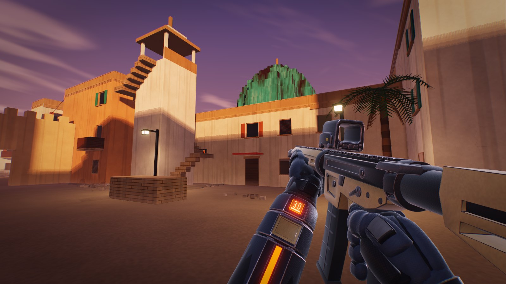
</p>

<h1 align="center">BlindDrop</h1>

<p align="center">
  <b>A free, private arena FPS in one C file.</b><br>
  Seven modes, eight maps, team play with friends, bots that push, and no telemetry.
</p>

<p align="center">
  <a href="https://github.com/ClaudiuJitea/BlindDrop/releases/latest"><b>Download for Linux and Windows</b></a>
</p>

<p align="center">
  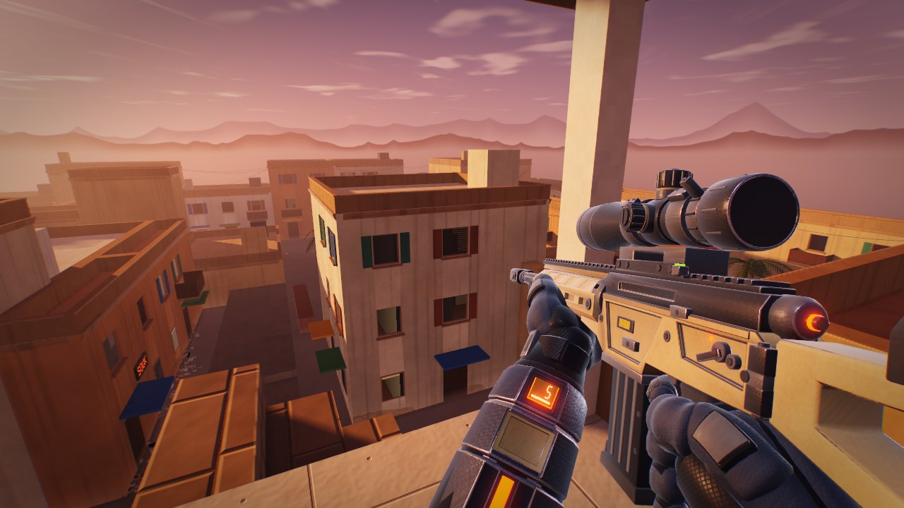
  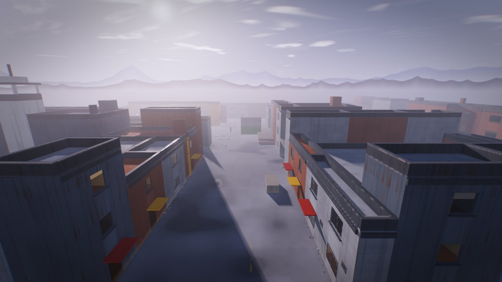
  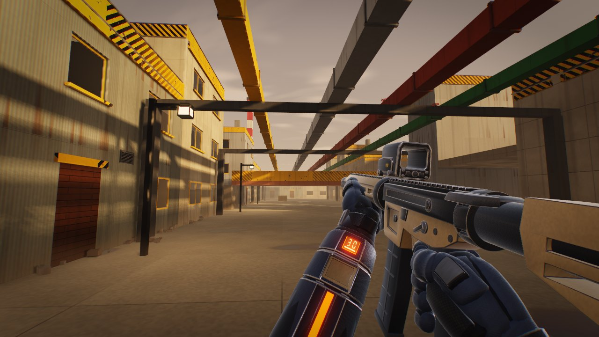
  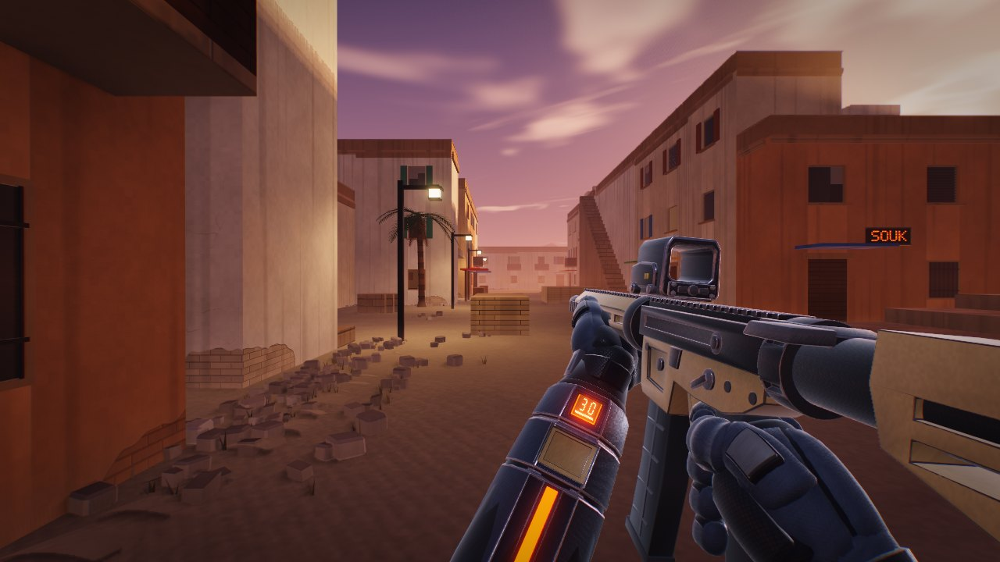
</p>

## The game

- **Play with friends:** one click hosts a game; everyone on your network sees it and joins with
  another. **Team Deathmatch** up to 9 v 9, ALPHA in red against BRAVO in blue, bots filling the gaps.
- **A hostage-rescue mission:** sneak into a guarded compound, free three hostages and walk them
  out to a helicopter.
- **Five weapons** on `1`-`5` (rifle, bolt sniper, sidearm, knife, frag grenades), no loadouts or
  unlocks. Grenades cook, bounce and roll; the knife chains slashes, guards and parries.
- **Weapon handling:** realistic magazine changes, scopes, sway and inertia, tracers from the muzzle
  to the impact, a mantle over low walls and ladders to climb.
- **Movement:** air control, a slide that carries speed, and `Q`/`E` lean.
- **Bots** hear you, remember you, flank, throw grenades and find their way around the big maps.
- **Armory:** five knives, eleven weapon themes and glove colourways (first-person looks only), plus
  the weapon's field of view and a lower hip position.
- **Match summary and career:** your headshots and best run each match, lifetime totals in `config.cfg`.
- **No engine and no asset files:** maps, models and every sound are generated in code, with
  physically based materials, soft shadows, ambient occlusion, light shafts and lit windows at dusk.

## Maps and modes

| Map | |
|---|---|
| **Arena** | Procedural: a new layout and sky every match. |
| **Foundry**, **Bazaar**, **Outpost** | Handmade 48 m arenas: a gantry and side halls, a market square with rooftops, long sniper lanes. |
| **Citadel** | 104 m desert old town: a domed mosque, a climbable minaret, arched gates and rooftop stairs. |
| **Harbor** | 104 m waterfront: brick warehouses, stacked containers, a crane walkway, a lighthouse and ladders up to the rooftops. |
| **Refinery** | 104 m industrial site: storage tanks, pipe racks over mid, a flare stack and a column lookout. |
| **Compound** | 104 m walled stronghold at blue hour, the Hostage Rescue map; also a normal map. |

| Mode | |
|---|---|
| **Deathmatch** | First to the frag limit. |
| **Team Deathmatch** | ALPHA (red) against BRAVO (blue), 1 v 1 up to 9 v 9; first side to the frag limit. |
| **Gun Game** | Two kills per weapon move you up the ladder; the first knife kill wins. |
| **Snipers Only** | The bolt sniper and nothing else. |
| **Knives + Nades** | The knife, with grenades that regrow. |
| **Last Man Standing** | No respawns; the last one alive takes the round. |
| **Hostage Rescue** | Operation Nightfall, a single-player stealth mission on Compound. |

Pick them under **Singleplayer** (they apply on the next restart); **Rotate** changes map every
match. A game you host has its own mode and map under **Multiplayer > Host settings**.

### Hostage Rescue

<p align="center">
  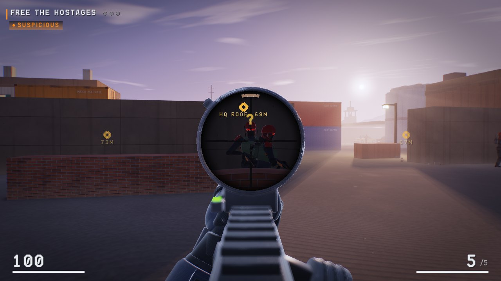
  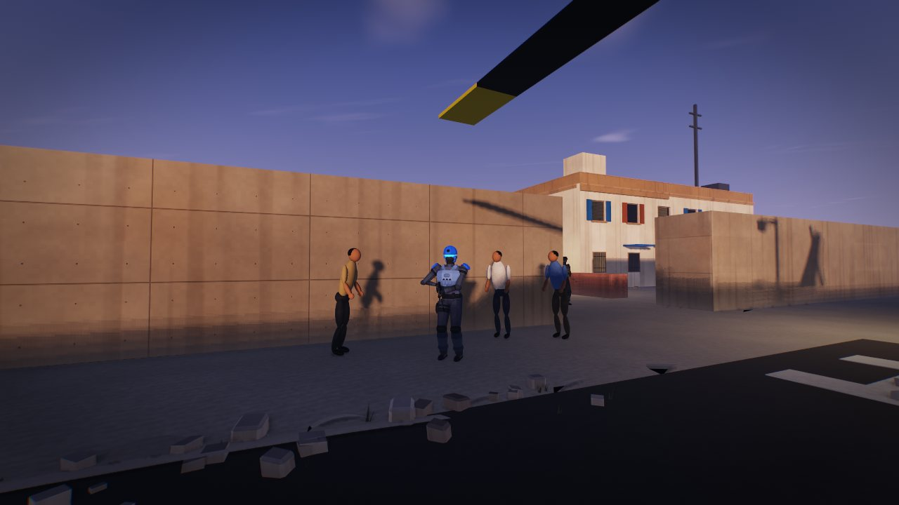
  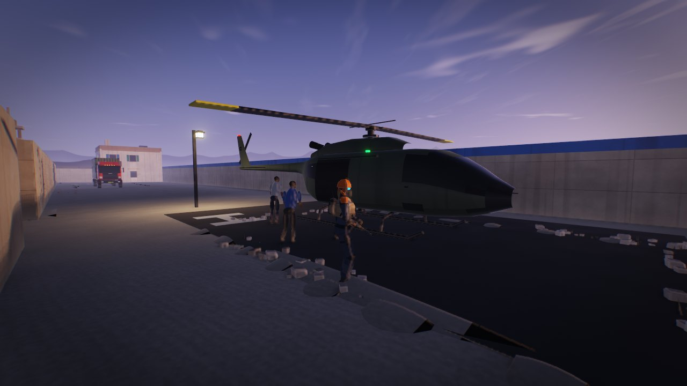
  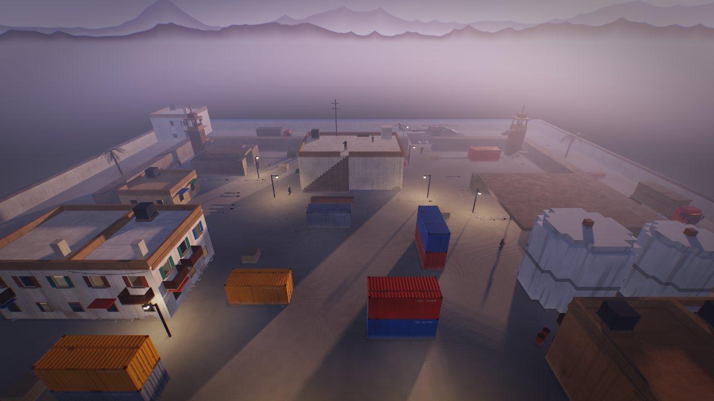
</p>

Three hostages are held in the pen, the motor pool and on the HQ roof. Hold **R** beside one to
cut the restraints, then lead all three to the helicopter outside the north gate. You carry a
suppressed sniper rifle (heard within about 15 m), a pistol and a knife.

Guards patrol, hold posts and watch from four towers. One who sees you fills a meter (an arc round
your crosshair, `?` over his head), faster when you are close, standing, moving or under a lamp. At
`!` he fires and radios the alarm unless you kill him first, and a guard who finds a body radios it
too. The alarm sends everyone hunting and starts the hostages' execution clock. A knife strike on a
guard who isn't fighting you is a silent takedown. Difficulty sets the guards (10, 14 or 18), their
sight, the radio delay and the execution timer (100, 75 or 55 s); the debrief rates you Ghost,
Shadow, Silent or Loud. Offline only.

## Download and run

**Linux** x86_64 with glibc 2.38+ (Ubuntu 23.10+, Debian 13+, Fedora 39+, Arch, SteamOS 3.7+):

```sh
chmod +x ./blinddrop-linux-amd64
./blinddrop-linux-amd64
```

**Windows** 10 or 11, 64-bit: run `blinddrop-windows-amd64.exe`. It is not code-signed, so
SmartScreen may ask you to confirm (More info > Run anyway). Windows can play and join; hosting
needs Linux. Check any download with `sha256sum -c SHA256SUMS`.

Low frame rate? Turn off **Post Effects** in Settings > Video. Settings > HUD has **Perf Stats**,
crosshair and HUD options, and **Enemy Markers** (a shape over enemies you can see, for players who
can't rely on colour). **Ballistics** in the Match tab gives rounds travel time, drag, drop and
ricochets; it is off by default and applies offline or on a server started with `--ballistics`.

## Multiplayer

<p align="center">
  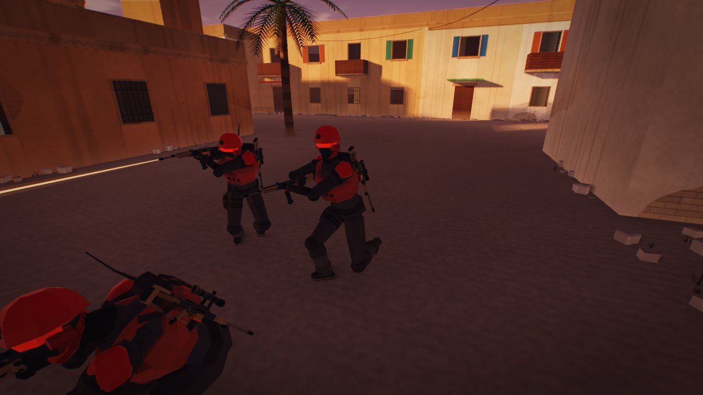
  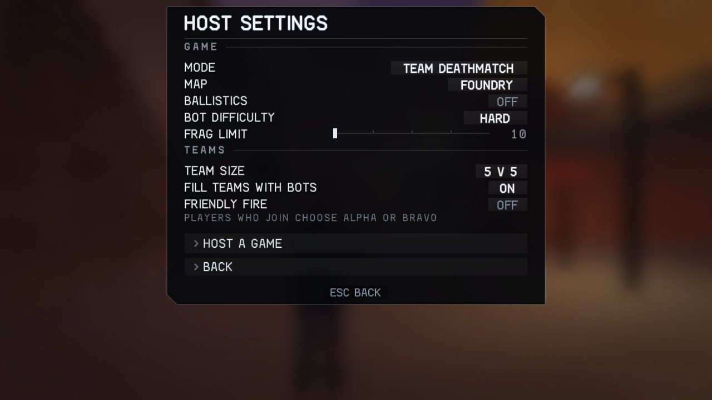
</p>

Up to 8 players per arena, with bots in the empty slots. Open **MULTIPLAYER**:

- **Host a game** starts a server on your PC and puts you in it; it shuts down when you leave.
  **Host settings** picks its mode, map, bots, difficulty and frag limit. Linux only.
- **Games on your network** lists every game on your LAN. Click one to join.
- **Join by address** takes an IP or `host:port`. Over the internet the host forwards UDP 31415.

In **Team Deathmatch** the host sets the team size (1 v 1 to 9 v 9), whether bots fill the empty
places (they step aside as players join) and friendly fire (off by default). Joining players pick
ALPHA or BRAVO on the **CHOOSE TEAM** page, and the **TEAM** tile switches sides mid-match.
Teammates carry a marker in their team colour, and the kill feed and scoreboard colour every name
by team. Offline, Singleplayer has Team Deathmatch too: you and bot teammates against a bot team.

A dedicated server works from the command line:

```sh
./blinddrop-linux-amd64 --server --mode tdm --team-size 5 --team-fill 1 --friendly-fire 0
./blinddrop-linux-amd64 --server --mode lms --map citadel --name "friday night"
./blinddrop-linux-amd64 --connect 192.168.1.50
```

Modes: `dm tdm gun sniper blades lms`. Maps: `arena foundry bazaar outpost citadel harbor refinery compound rotate`.

## Privacy

No telemetry, no update checks and no built-in servers. The game only uses the network when you join
or host, and only to the server you choose. That traffic is not encrypted, and a server sees your IP
address and player name, so only join servers you trust.

## Build from source

Needs gcc 14+, make, and the EGL, GL and X11 development headers:

```sh
make build/game-x86_64
./build/game-x86_64
```

`make dist-linux RELEASE_VERSION=v0.7` builds the redistributable binary (needs Docker). The
first-person models come from `tools/build_models.py`, regenerated with
`blender -b --factory-startup -P tools/build_models.py`.

## Credits and license

BlindDrop is an independent modified version of
[skill-issue by codehamr](https://codehamr.com). It is not affiliated with or endorsed by codehamr.

It is licensed under the [PolyForm Noncommercial License 1.0.0](LICENSE). You can read, change
and share it for noncommercial purposes. Commercial use is not permitted.

Required Notice: Copyright (c) 2026 codehamr (https://codehamr.com)
