<p align="center">
  
</p>

<h1 align="center">BlindDrop</h1>

<p align="center">
  <b>A free, private arena FPS in one C file.</b><br>
  Seven modes, eight maps, team play with friends, bots that push, and no telemetry.
</p>

<p align="center">
  <a href="https://github.com/ClaudiuJitea/BlindDrop/releases/latest"><b>Download for Linux and Windows</b></a>
</p>

<p align="center">
  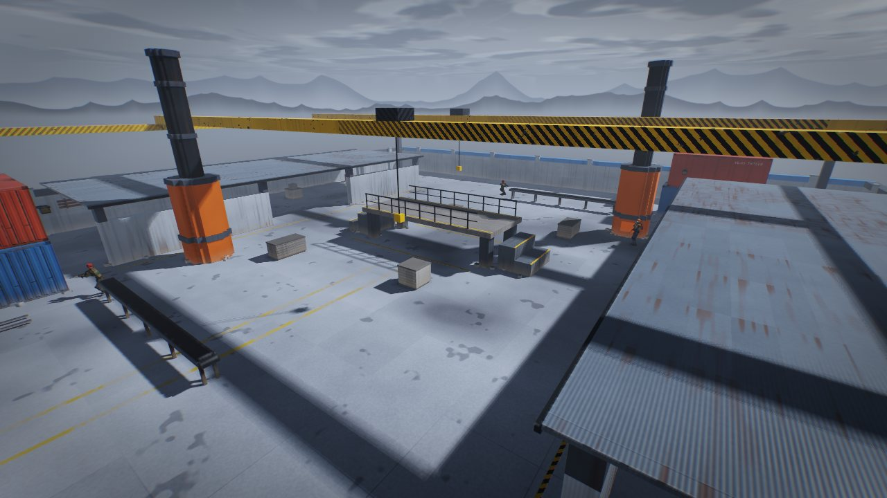
  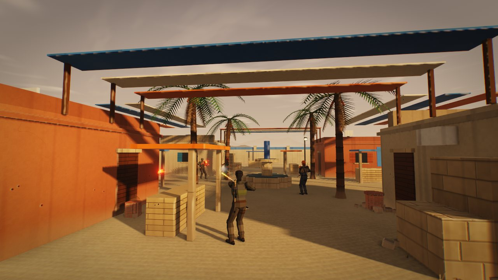
  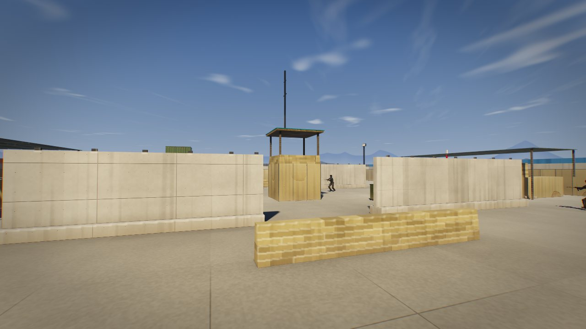
  
</p>

## The game

- **Play with friends:** one click hosts a game; everyone on your network sees it and joins with
  another. **Team Deathmatch** up to 9 v 9, ALPHA in red against BRAVO in blue, bots filling the gaps.
- **A hostage-rescue mission:** sneak into a guarded compound, free three hostages and walk them
  out to a helicopter, alone or as a squad of up to three with friends and bots.
- **Five weapons** on `1`-`5` (rifle, bolt sniper, sidearm, knife, frag grenades), no loadouts or
  unlocks. Grenades cook, bounce and roll; the knife chains slashes, guards and parries.
- **Weapon handling:** realistic magazine changes, scopes, sway and inertia, tracers from the muzzle
  to the impact, a mantle over low walls and ladders to climb.
- **Movement:** air control, a slide that carries speed, and `Q`/`E` lean.
- **Bots** hear you, remember you, flank, throw grenades and find their way around the big maps.
- **Two forces you can tell apart by shape:** you and your side are operators (helmet, goggles,
  plate carrier, pack); whoever you're fighting are insurgents (head wrap, face scarf, light chest
  rig, no armour), on every map and in every mode. Team games keep their red and blue on top.
- **Third person (`V`):** your operator wears the outfit you pick, carries the rifles he isn't using
  on his back and the pistol in a thigh holster, and stows one weapon and draws the next when you switch.
- **Armory:** five knives and eleven weapon themes; five outfit colourways with a choice of headgear,
  vest and pack for your operator; the weapon's field of view and a lower hip position.
- **Match summary and career:** your headshots and best run each match, lifetime totals in `config.cfg`.
- **No engine and no asset files:** maps, models and every sound are generated in code, with
  physically based materials, soft shadows, ambient occlusion, light shafts and lit windows at dusk.

## Your operator

<p align="center">
  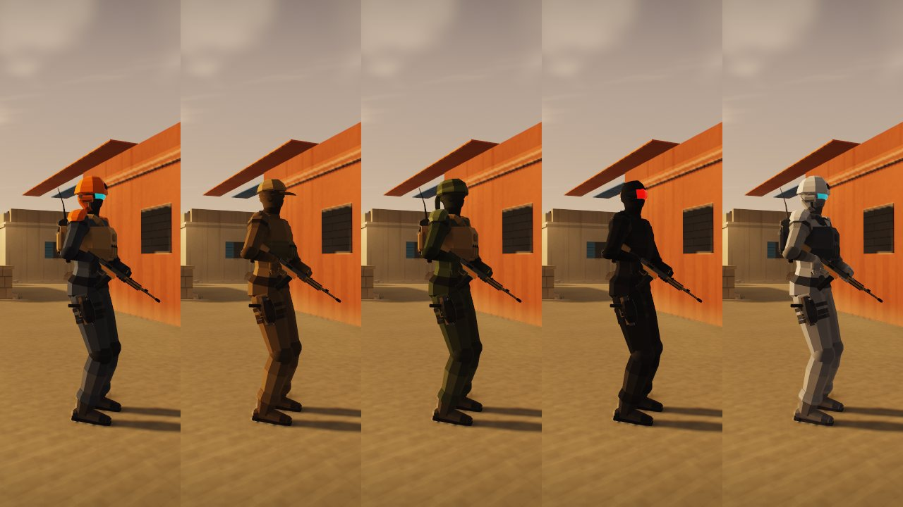
  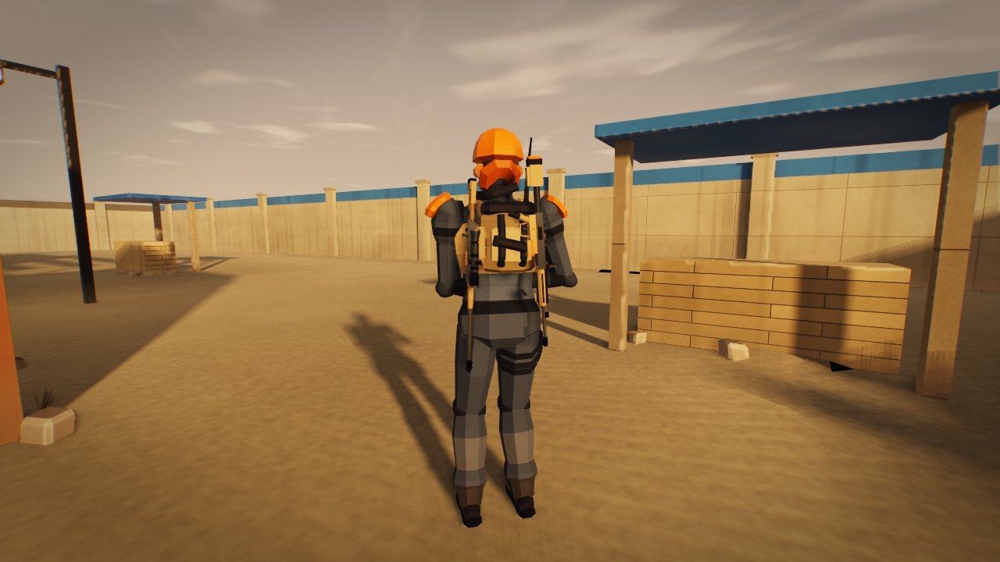
  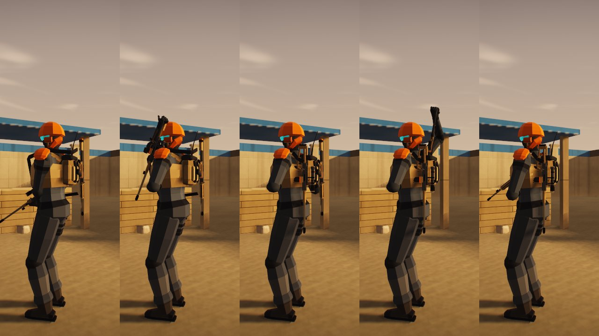
  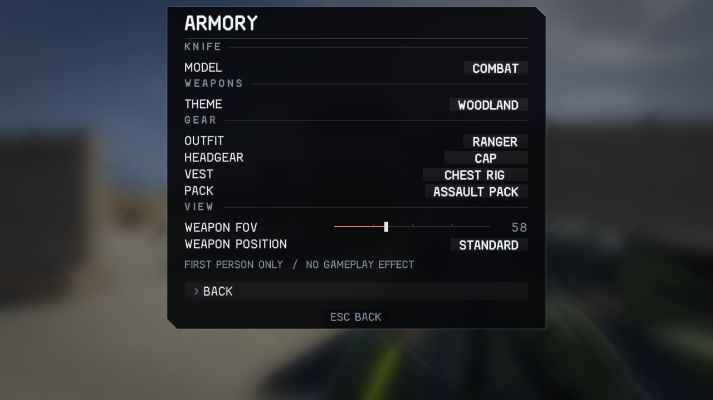
</p>

<p align="center">
  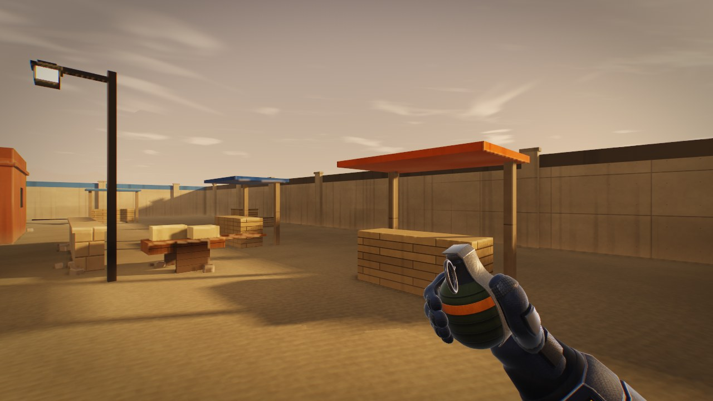
  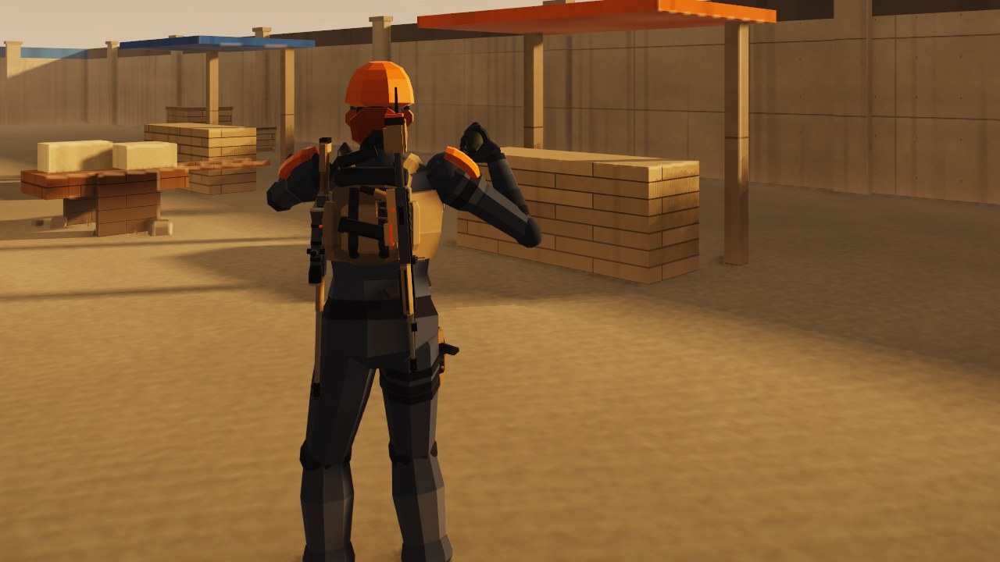
  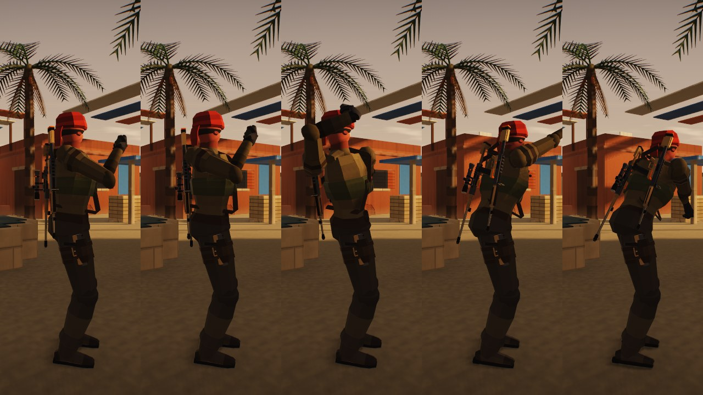
  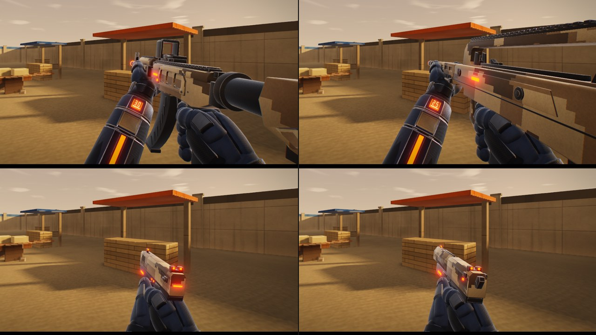
</p>

Pick your look under **Armory > Gear**: **OUTFIT** (slate, coyote, ranger, shadow, arctic) colours the
whole kit, from fatigues and plate carrier to helmet, gloves and goggles; **HEADGEAR** is a helmet,
cap, head wrap or bare; **VEST** a plate carrier, chest rig or none; **PACK** an assault pack or none.
Press `V` for the shoulder camera. The carbine rides on your back, the sniper down your left side and
the pistol in a drop-leg holster; switching weapons puts the old one away and draws the new one,
over the shoulder for a rifle and from the holster for the pistol. It is all looks: nothing here
changes how a weapon handles, and in team games your side's colours stay on top.

## Maps and modes

| Map | |
|---|---|
| **Arena** | Procedural: a new layout and sky every match. |
| **Foundry** | Handmade 48 m steelworks yard: furnace stacks, a railed gantry, an overhead crane, roofed sheds, containers and a conveyor. |
| **Bazaar** | Handmade 48 m market quarter: houses with rooftops, striped canopies over the streets, stalls, palms and a fountain square. |
| **Outpost** | Handmade 48 m forward base: T-wall lanes, HESCO and sandbags, a watchtower, container perches, long sniper lines. |
| **Citadel** | 104 m desert old town: a domed mosque, a climbable minaret, arched gates and rooftop stairs. |
| **Harbor** | 104 m waterfront: brick warehouses, stacked containers, a crane walkway, a lighthouse and ladders up to the rooftops. |
| **Refinery** | 104 m industrial site: storage tanks, pipe racks over mid, a flare stack and a column lookout. |
| **Compound** | 104 m walled stronghold at blue hour, the Hostage Rescue map; also a normal map. |

| Mode | |
|---|---|
| **Deathmatch** | First to the frag limit. |
| **Team Deathmatch** | ALPHA (red) against BRAVO (blue), 1 v 1 up to 9 v 9; first side to the frag limit. |
| **Gun Game** | Two kills per weapon move you up the ladder; the first knife kill wins. |
| **Snipers Only** | The bolt sniper and nothing else. |
| **Knives + Nades** | The knife, with grenades that regrow. |
| **Last Man Standing** | No respawns; the last one alive takes the round. |
| **Hostage Rescue** | Operation Nightfall, a stealth mission on Compound for a squad of one to three, players and bots. |

Pick them under **Singleplayer** (they apply on the next restart); **Rotate** changes map every
match. A game you host has its own mode and map under **Multiplayer > Host settings**.

### Hostage Rescue

<p align="center">
  
  
  
  
</p>

Three hostages are held in the pen, the motor pool and on the HQ roof. Hold **R** beside one to
cut the restraints, then lead all three to the helicopter outside the north gate. You carry a
suppressed sniper rifle (heard within about 15 m), a pistol and a knife.

Guards patrol, hold posts and watch from four towers. One who sees you fills a meter (an arc round
your crosshair, `?` over his head), faster when you are close, standing, moving or under a lamp. At
`!` he fires and radios the alarm unless you kill him first, and a guard who finds a body radios it
too. The alarm sends everyone hunting and starts the hostages' execution clock. A knife strike on a
guard who isn't fighting you is a silent takedown. Difficulty sets the guards (10, 14 or 18), their
sight, the radio delay and the execution timer (100, 75 or 55 s); the debrief rates you Ghost,
Shadow, Silent or Loud.

**The squad.** **SQUAD** (Singleplayer, or Host settings) is one to three operators. Players take
the places first and bots fill the rest, stepping aside as friends join. Every operator past the
first brings two more guards, up to 18: a squad of three on Easy faces 14, on Normal or Hard 18.
Squad bots stay a few metres behind the nearest player, crouch when you crouch, watch your flanks
and cut a hostage loose when you're both beside one. They hold fire until a guard is onto the
squad, the alarm is up or a player opens fire. Freed hostages follow whoever cut them free (a bot
hands them on to the nearest player). The mission fails only when the whole squad is down;
a fallen operator watches the others carry on.

## Download and run

**Linux** x86_64 with glibc 2.38+ (Ubuntu 23.10+, Debian 13+, Fedora 39+, Arch, SteamOS 3.7+):

```sh
chmod +x ./blinddrop-linux-amd64
./blinddrop-linux-amd64
```

**Windows** 10 or 11, 64-bit: run `blinddrop-windows-amd64.exe`. It is not code-signed, so
SmartScreen may ask you to confirm (More info > Run anyway). Windows can play and join; hosting
needs Linux. Check any download with `sha256sum -c SHA256SUMS`.

Low frame rate? Turn off **Post Effects** in Settings > Video. Settings > HUD has **Perf Stats**,
crosshair and HUD options, and **Enemy Markers** (a shape over enemies you can see, for players who
can't rely on colour). **Ballistics** in the Match tab gives rounds travel time, drag, drop and
ricochets; it is off by default and applies offline or on a server started with `--ballistics`.

## Multiplayer

<p align="center">
  
  
</p>

Up to 8 players per arena, with bots in the empty slots. Open **MULTIPLAYER**:

- **Host a game** starts a server on your PC and puts you in it; it shuts down when you leave.
  **Host settings** picks its mode, map, bots, difficulty and frag limit. Linux only.
  **Hostage Rescue** hosts the mission as a co-op game: up to three players, bots in the free places.
- **Games on your network** lists every game on your LAN. Click one to join.
- **Join by address** takes an IP or `host:port`. Over the internet the host forwards UDP 31415.

In **Team Deathmatch** the host sets the team size (1 v 1 to 9 v 9), whether bots fill the empty
places (they step aside as players join) and friendly fire (off by default). Joining players pick
ALPHA or BRAVO on the **CHOOSE TEAM** page, and the **TEAM** tile switches sides mid-match.
Teammates carry a marker in their team colour, and the kill feed and scoreboard colour every name
by team. Offline, Singleplayer has Team Deathmatch too: you and bot teammates against a bot team.

A dedicated server works from the command line:

```sh
./blinddrop-linux-amd64 --server --mode tdm --team-size 5 --team-fill 1 --friendly-fire 0
./blinddrop-linux-amd64 --server --mode lms --map citadel --name "friday night"
./blinddrop-linux-amd64 --server --mode rescue --squad 3 --skill 1
./blinddrop-linux-amd64 --connect 192.168.1.50
```

Modes: `dm tdm gun sniper blades lms rescue`. Maps: `arena foundry bazaar outpost citadel harbor refinery compound rotate`.

## Privacy

No telemetry, no update checks and no built-in servers. The game only uses the network when you join
or host, and only to the server you choose. That traffic is not encrypted, and a server sees your IP
address and player name, so only join servers you trust.

## Build from source

Needs gcc 14+, make, and the EGL, GL and X11 development headers:

```sh
make build/game-x86_64
./build/game-x86_64
```

`make dist-linux RELEASE_VERSION=v0.7.7` builds the redistributable binary (needs Docker). The
first-person models come from `tools/build_models.py`, regenerated with
`blender -b --factory-startup -P tools/build_models.py`.

## Credits and license

BlindDrop is an independent modified version of
[skill-issue by codehamr](https://codehamr.com). It is not affiliated with or endorsed by codehamr.

It is licensed under the [PolyForm Noncommercial License 1.0.0](LICENSE). You can read, change
and share it for noncommercial purposes. Commercial use is not permitted.

Required Notice: Copyright (c) 2026 codehamr (https://codehamr.com)
