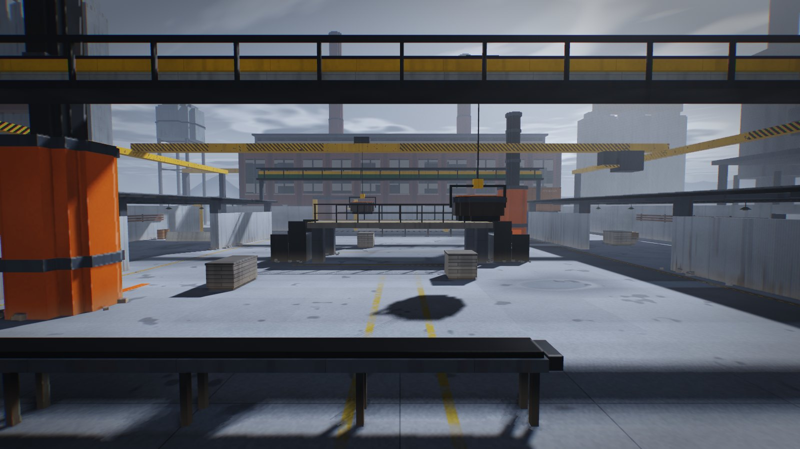
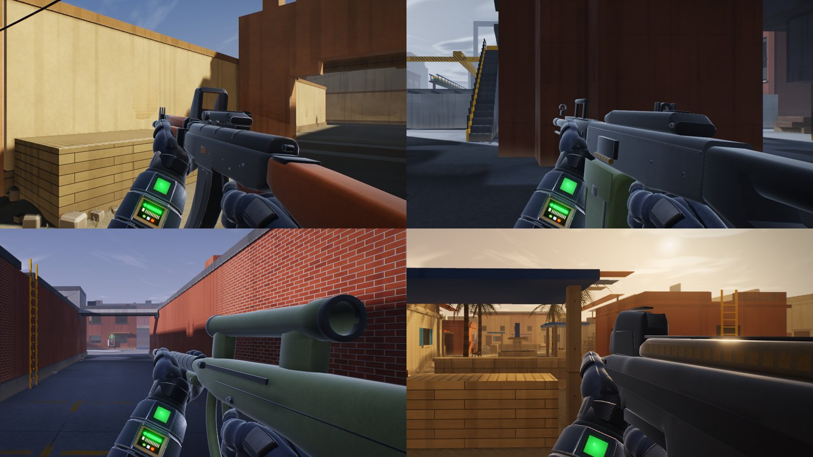
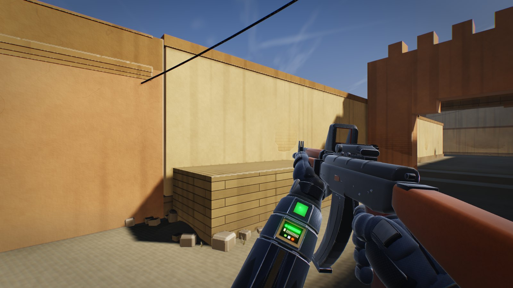
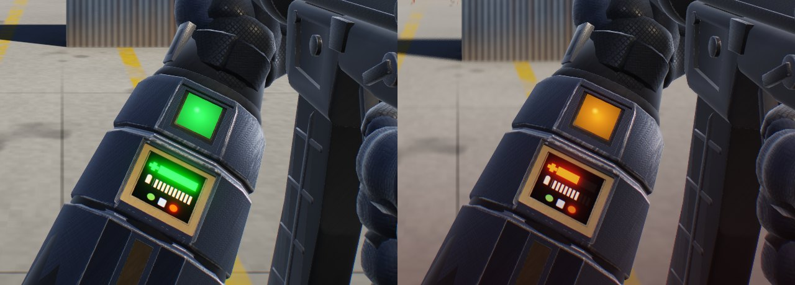
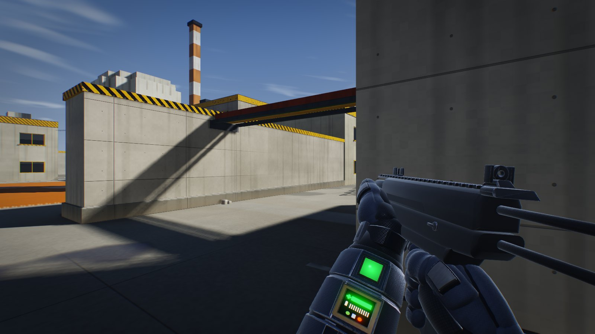
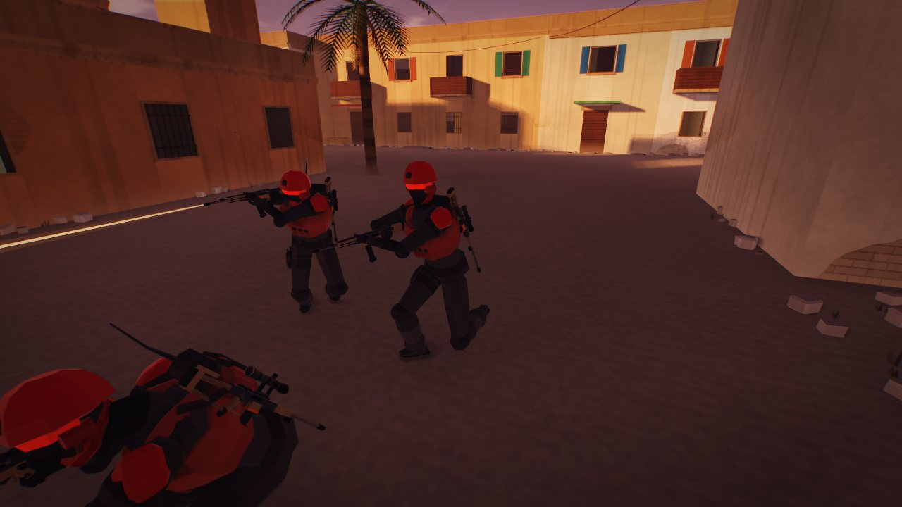
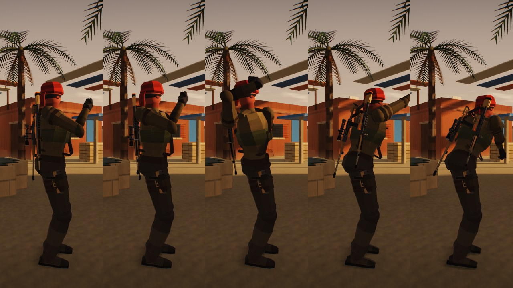

<p align="center">
  
</p>

<h1 align="center">BlindDrop</h1>

<p align="center">
  <b>A free, private arena FPS written from scratch in C.</b><br>
  Seven modes, eight maps, 34 weapons, team play with friends, bots that push, no telemetry.<br>
  <a href="https://github.com/ClaudiuJitea/BlindDrop/releases/latest"><b>Download for Linux and Windows</b></a>
</p>

<p align="center">
  
  
  
  
</p>

## New in 0.8.5

- **Rebuilt guns:** all 34 have new shaped bodies modelled on reference photos, replacing the flat
  extruded shapes. The MAC-10, Tec-9, MP7 and P90 have their own grips and hand poses. The stock
  and butt pad stay on during reloads, and parts of the AK-47 that were only on one side are now
  on both.
- **Foundry, rebuilt:** new architecture all round, gates and back doors leading out of the main
  yard into the works, and stairs up to some of the big roofs.
- **Cleaner maps:** Citadel now plays under a clear afternoon sky and Refinery on a crisp morning,
  with the brown haze gone, and the other maps are tidied up too.
- **A forearm status screen:** your gauntlet shows health (green, then amber, then red), your
  magazine and your grenades as shapes rather than numbers, and flashes red when you're hit. Pick its
  layout under **Armory > Gear > Wrist**.

0.8.5 plays with 0.8 to 0.8.2 (same network protocol, 22).

## The game

- **34 weapons, no unlocks:** 20 primaries, 10 pistols and 4 snipers under **Armory > Loadout**,
  each with its own model, handling and recorded sound. `B` switches fire mode where a gun has one.
- **Grenades, 3 of each type per life:** frag (`5`), a smoke (`6`) that fills the space it lands
  in, and an incendiary (`7`) that spreads fire across the floor.
- **Supplies:** medical stations give +50 health and ammunition crates restock your grenades. Each
  one refills 25 seconds after it's used.
- **Movement and handling:** magazine changes, scopes, sway, short tracers, mantling, ladders, a
  slide that keeps your speed, and `Q`/`E` to lean.
- **Bots** hear and remember you, flank, throw grenades and use supplies.
- **Your operator:** pick an outfit, headgear, face gear, vest and pack under **Armory > Gear**.
  Press `V` for third person: rifles ride on your back and the pistol in a thigh holster.
- **Wounds:** blood lands on the side the hit came from, and the screen drains and crusts as your
  health drops.
- **No engine, no asset files:** maps are generated in code, and the models and sound bank are
  built into the one binary.

<p align="center">
  
  
  
  
  
  
</p>

## Maps and modes

| Map | |
|---|---|
| **Arena** | Procedural: a new layout and sky every match. |
| **Foundry** | 104 m steelworks: a yard with gates out into the works, sheds, a crane with its ladle, pipe bridges, mill halls and a blast furnace, with stairs up to some roofs. |
| **Bazaar** | 48 m market quarter: climbable roofs, canopies, stalls and a fountain square. |
| **Outpost** | 48 m forward base: T-wall lanes, HESCO, a watchtower and sniper bastions. |
| **Citadel** | 104 m desert old town: a mosque, a climbable minaret, gates and covered alleys. |
| **Harbor** | 104 m waterfront: warehouses, containers, a crane walkway and a lighthouse. |
| **Refinery** | 104 m industrial site: tanks, pipe racks, a catwalk bridge and a flare stack. |
| **Compound** | 104 m walled stronghold at blue hour, where Hostage Rescue is played. |

**Modes:** Deathmatch, Team Deathmatch (up to 9 v 9), Gun Game, Snipers Only, Knives + Nades,
Last Man Standing, and **Hostage Rescue**, a stealth mission for a squad of one to three: free three
hostages and lead them to the helicopter before the guards raise the alarm. You choose these under
**Singleplayer** (they take effect on the next restart), and **Rotate** changes the map every match.

## Download and run

**Linux**, x86_64 with glibc 2.38+ (Ubuntu 23.10+, Debian 13+, Fedora 39+, Arch, SteamOS 3.7+):

```sh
chmod +x ./blinddrop-linux-amd64 && ./blinddrop-linux-amd64
```

**Windows** 10 or 11, 64-bit: run `blinddrop-windows-amd64.exe`. It isn't code-signed, so
SmartScreen may ask you to confirm (More info > Run anyway). Windows can play and join, but hosting
needs Linux. You can check any download with `sha256sum -c SHA256SUMS`.

If the frame rate is low, turn off **Post Effects** in Settings > Video.

## Multiplayer

Under **MULTIPLAYER**: **Host a game** starts a server on your PC (Linux only), **Games on your
network** lists LAN games, and **Join by address** takes `host:port` (forward UDP 31415 to play
over the internet). Up to 8 players per arena, with bots filling the empty places.

```sh
./blinddrop-linux-amd64 --server --mode tdm --team-size 5 --team-fill 1
./blinddrop-linux-amd64 --server --mode rescue --squad 3 --skill 1
./blinddrop-linux-amd64 --connect 192.168.1.50
```

Modes: `dm tdm gun sniper blades lms rescue`. Maps: `arena foundry bazaar outpost citadel harbor refinery compound rotate`.

## Privacy

No telemetry, no update checks and no built-in servers. The game only uses the network when you
join or host, and only to the server you choose. That traffic isn't encrypted, and a server sees
your IP address and player name, so only join servers you trust.

## Build from source

Needs gcc 14+, make, and the EGL, GL and X11 development headers:

```sh
make build/game-x86_64 && ./build/game-x86_64
```

`code/game.c` `#include`s the parts under `code/` in a fixed order, so the whole game builds as a
single translation unit (a unity build). The baked meshes in `code/models.h` and `code/models_2.h`
are generated with `blender -b --factory-startup -P tools/build_models.py`, and the world props with
`tools/build_props.py`.

## Credits and license

BlindDrop is an independent modified version of
[skill-issue by codehamr](https://codehamr.com). It is not affiliated with or endorsed by codehamr.
It is licensed under the [PolyForm Noncommercial License 1.0.0](LICENSE): you can read, change and
share it for noncommercial purposes, but commercial use is not permitted.

Required Notice: Copyright (c) 2026 codehamr (https://codehamr.com)
