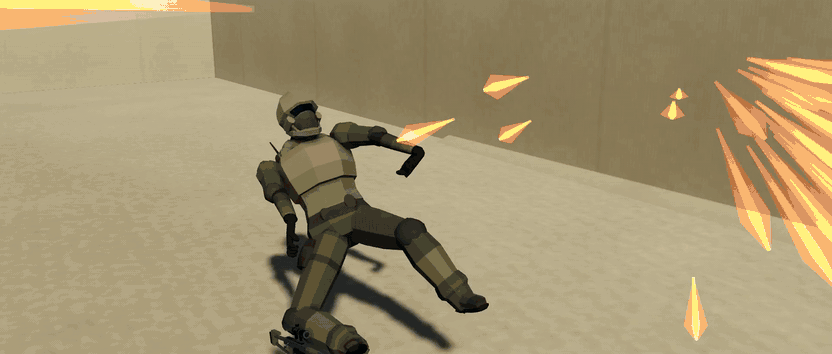
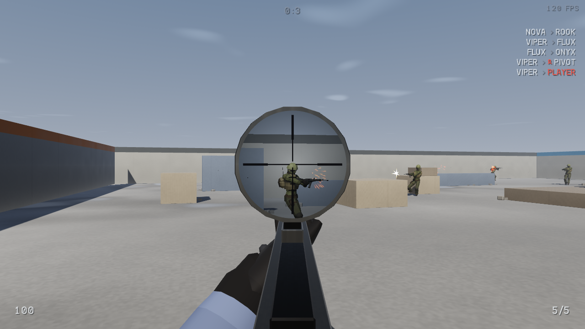

<p align="center">
  
</p>

<h1 align="center">BlindDrop</h1>

<p align="center">
  <b>New arena. No map knowledge. Just aim and movement.</b><br>
  A free, private arena FPS with procedural maps and no telemetry.
</p>

<p align="center">
  <a href="https://github.com/ClaudiuJitea/BlindDrop/releases/latest"><b>Download for Linux</b></a>
</p>

<p align="center">
  
  
</p>

## The game

- **Dropped in blind.** Every match generates a new arena, along with its weapons, characters and sounds, so nobody starts with map knowledge.
- **Two guns, everyone gets both.** A hitscan rifle and a bolt sniper. No loadouts, unlocks or attachments.
- **Movement you can get good at.** Air control, a slide that carries speed, and `Q`/`E` lean.
- **Bots that make solo worthwhile.** They hear you, remember you and push.
- **One small executable.** Plain C with no engine and no asset files.

## Download and run

BlindDrop currently ships as a Linux x86_64 binary. It needs glibc 2.38 or newer: Ubuntu 23.10+,
Debian 13+, Fedora 39+, Arch or SteamOS 3.7+.

```sh
chmod +x ./blinddrop-linux-amd64
./blinddrop-linux-amd64
```

Each release includes a `SHA256SUMS` file, which you can check with `sha256sum -c SHA256SUMS`.

## Privacy

BlindDrop contacts nothing on its own.

| | |
|---|---|
| Telemetry | None |
| Update checks | None |
| Built-in servers | None |
| Singleplayer network traffic | None |
| Multiplayer network traffic | Only to the server you choose, over UDP |

Multiplayer traffic is not encrypted, and any server you join sees your IP address and player
name. Only join servers you trust.

## Multiplayer

Anyone can host from a Linux build. The default port is UDP 31415.

```sh
./blinddrop-linux-amd64 --server
```

To join, pass the address when you launch:

```sh
./blinddrop-linux-amd64 --connect 192.168.1.50
./blinddrop-linux-amd64 --connect example.com:31415
```

Or add it to `config.cfg` next to the binary, and **Quick Join** in the menu will use it:

```
mp_host 192.168.1.50
mp_port 31415
```

Up to 8 people can play in each arena, and bots fill the empty slots.

## Build from source

You need gcc 14 or newer, make, and the EGL, GL and X11 development headers.

```sh
make build/game-x86_64
./build/game-x86_64
```

To build the same redistributable binary as a release, which needs Docker:

```sh
make dist-linux RELEASE_VERSION=v0.1.0
```

## Credits and license

BlindDrop is an independent modified version of
[skill-issue by codehamr](https://codehamr.com). It is not affiliated with or endorsed by codehamr.

It is licensed under the [PolyForm Noncommercial License 1.0.0](LICENSE). You can read, change
and share it for noncommercial purposes. Commercial use is not permitted.

Required Notice: Copyright (c) 2026 codehamr (https://codehamr.com)
